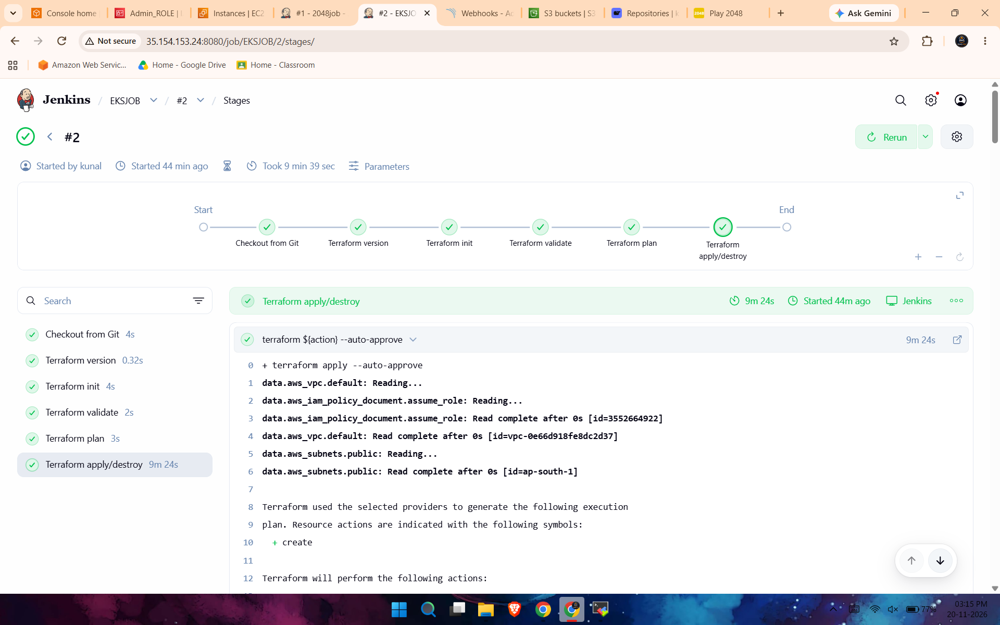
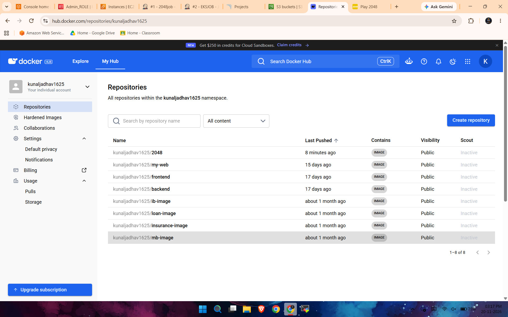
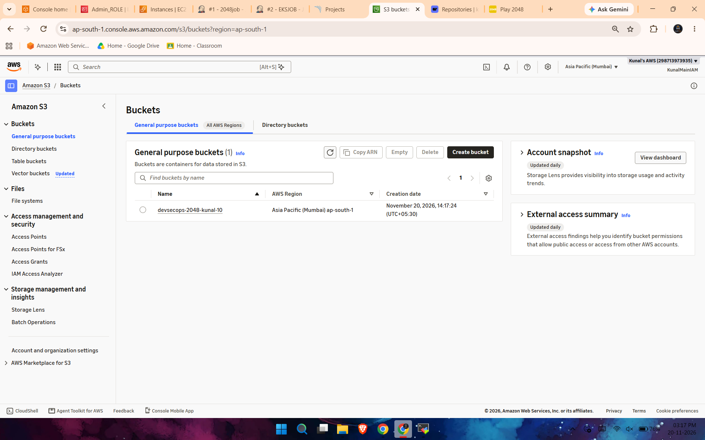
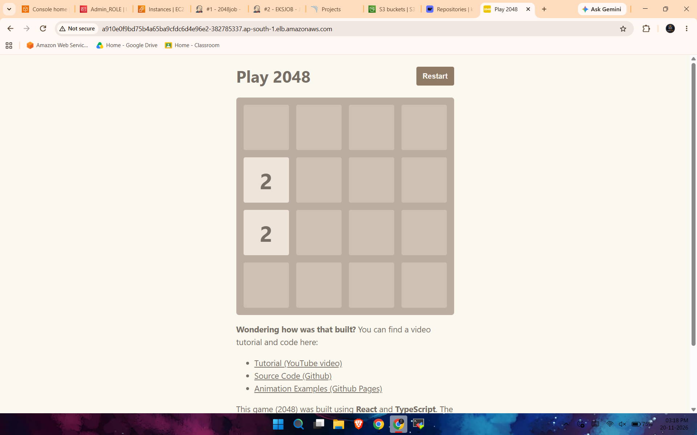

# DevSecOps CI/CD Pipeline for 2048 on Amazon EKS

<div align="center">


**A hands-on DevSecOps implementation that automates infrastructure, code quality checks, vulnerability scanning, container delivery, and Kubernetes deployment.**


</div>

## Overview

This project documents an end-to-end DevSecOps workflow for deploying a containerized 2048 web game to Amazon Elastic Kubernetes Service (Amazon EKS).

The Jenkins pipelines provision AWS infrastructure with Terraform and automate application delivery through:

- Source checkout and dependency installation
- SonarQube static code analysis and quality gates
- Trivy filesystem and container image scanning
- Docker image build and push to Docker Hub
- Deployment to Amazon EKS
- Docker container validation

> This repository is primarily an implementation guide and evidence archive. The application source, Terraform modules, and Jenkinsfile are referenced as separate or external assets rather than stored as local directories in this repository.

## Architecture

The workflow follows a single delivery path:

```text
Developer
   │
   ▼
GitHub ── webhook ──► Jenkins
                         │
                         ├──► SonarQube ── Code quality & quality gate
                         ├──► Trivy ─────── Filesystem & image vulnerability scan
                         ├──► npm ───────── Dependency installation & build
                         └──► Docker ────── Build & push image
                                              │
                                              ▼
                                      Docker Hub Registry
                                              │
                                              ▼
                                      Amazon EKS Cluster
                                              │
                                              ▼
                                      2048 Game Service
```

Infrastructure is provisioned through Terraform and stored in Amazon S3 as a remote backend.

## Technology Stack

| Category | Tools |
|---|---|
| Cloud | Amazon Web Services |
| Compute | Amazon EC2, Amazon EKS |
| CI/CD | Jenkins |
| Infrastructure as Code | Terraform |
| Containers | Docker |
| Orchestration | Kubernetes |
| Code Analysis | SonarQube |
| Vulnerability Scanning | Trivy |
| Package Management | npm |
| Registry | Docker Hub |
| Remote State | Amazon S3 |

## CI/CD Workflow

### 1. Infrastructure Pipeline

1. Checkout the infrastructure repository.
2. Initialize Terraform.
3. Validate and plan the configuration.
4. Apply or destroy the AWS resources using a Jenkins parameter.
5. Create or remove the EKS cluster and networking resources.

### 2. Application Pipeline

1. Clean the Jenkins workspace.
2. Checkout the 2048 application source.
3. Run SonarQube analysis.
4. Wait for the configured quality gate.
5. Install npm dependencies.
6. Scan the project filesystem with Trivy.
7. Build the Docker image.
8. Push the image to Docker Hub.
9. Scan the built image with Trivy.
10. Run the container for validation.
11. Deploy the Kubernetes workload to EKS.

## Prerequisites

- An AWS account with permissions to manage EC2, EKS, IAM, VPC, and S3
- Ubuntu-based EC2 instance
- Jenkins installed on the EC2 instance
- Docker
- Java 21 or later
- Terraform
- AWS CLI
- kubectl
- Node.js and npm
- SonarQube
- Trivy
- A Docker Hub account
- A GitHub repository containing the 2048 application

## Jenkins Configuration

### Required Jenkins Plugins

- Eclipse Temurin installer
- SonarQube Scanner
- NodeJS
- OWASP Dependency-Check
- Docker
- Docker Pipeline
- Docker Commons
- Docker API
- Docker Build Step
- Kubernetes
- Kubernetes CLI

### Required Jenkins Credentials

| Credential ID | Type | Purpose |
|---|---|---|
| `sonar-token` | Secret text | SonarQube authentication |
| `docker` | Username and password | Docker Hub registry access |
| `k8s` | Secret file | EKS kubeconfig access |

Do not place credentials or kubeconfig files directly in source control.

## Infrastructure Provisioning

Configure the AWS CLI on the Jenkins/EC2 host:

```bash
aws configure
aws sts get-caller-identity
```

Create an EKS cluster with the infrastructure pipeline, or initialize the Terraform configuration manually:

```bash
terraform init
terraform validate
terraform plan
terraform apply
```

Update the kubeconfig after cluster creation:

```bash
aws eks update-kubeconfig \
  --name EKS_CLUSTER \
  --region ap-south-1
```

Verify the cluster:

```bash
kubectl get nodes
kubectl get all
```

## Application Deployment

Example container operations:

```bash
docker build -t 2048 .
docker tag 2048 <dockerhub-user>/2048:latest
docker push <dockerhub-user>/2048:latest
docker run -d --name 2048 -p 3000:3000 <dockerhub-user>/2048:latest
```

Deploy the Kubernetes manifests:

```bash
kubectl apply -f deployment.yaml
kubectl get pods
kubectl get service
```

Open the external load balancer address shown by `kubectl get service` to access the 2048 game.

## Security Scanning

Run a filesystem scan before building:

```bash
trivy fs .
```

Scan the generated container image:

```bash
trivy image <dockerhub-user>/2048:latest
```

Recommended security practices:

- Rotate exposed credentials immediately.
- Store secrets in Jenkins Credentials or AWS Secrets Manager.
- Keep Jenkins and SonarQube behind appropriate network controls.
- Avoid public Kubernetes API or Jenkins endpoints unless required.
- Review Trivy findings and set appropriate pipeline failure thresholds.
- Restrict the Jenkins EC2 IAM role using least-privilege permissions.

> [!IMPORTANT]
> The repository currently contains or has contained sensitive environment artifacts. Never commit kubeconfig files, AWS credentials, Docker passwords, SonarQube tokens, certificates, or private keys. Rotate any values that have already been shared.

## Project Screenshots

### Jenkins Pipeline


### EKS Kubernetes Pipeline



### Docker Hub Images



### SonarQube Status


### AWS Infrastructure Evidence

| EC2 Instances | S3 Buckets | IAM Role |
|---|---|---|
|  |  |  |

### Deployed Application



## Repository Guide

| Path | Purpose |
|---|---|
| [`Architecture-diagram.png`](./Architecture-diagram.png) | DevSecOps workflow architecture |
| [`Deploying 2048 Game - new.txt`](./Deploying%202048%20Game%20-%20new.txt) | Detailed setup and Jenkins pipeline notes |
| [`errors.txt`](./errors.txt) | Recorded troubleshooting information |
| [`screenshoots/`](./screenshoots/) | AWS, Jenkins, SonarQube, Docker, Kubernetes, and application evidence |
| [`secret.txt`](./secret.txt) | Local kubeconfig reference; do not commit or publish |

## Cleanup

Destroy the infrastructure when it is no longer required:

```bash
terraform destroy
```

Remove the Jenkins container and application container if needed:

```bash
docker ps -a
docker rm -f <container-id>
```

## Troubleshooting

### Docker permission denied

```bash
sudo chmod 777 /var/run/docker.sock
sudo systemctl restart docker
docker ps
```

### Kubernetes authentication failure

```bash
aws eks update-kubeconfig \
  --name EKS_CLUSTER \
  --region ap-south-1

kubectl get nodes
```

### Load balancer not accessible

Verify the Kubernetes service type and ensure the EKS security groups allow the required inbound traffic from the public internet.

### Jenkins cannot access Docker

Restart Docker and add the Jenkins user to the Docker group if the environment requires it:

```bash
sudo usermod -aG docker jenkins
sudo systemctl restart docker
```

## Contributing

Contributions are welcome:

1. Fork the repository.
2. Create a descriptive feature branch.
3. Commit the changes with a clear message.
4. Open a pull request.

## License

Add a LICENSE file before defining the legal terms for reuse and distribution.

## Author

**Kunal Jadhav**

- GitHub: [devkunaljadhav](https://github.com/devkunaljadhav)
