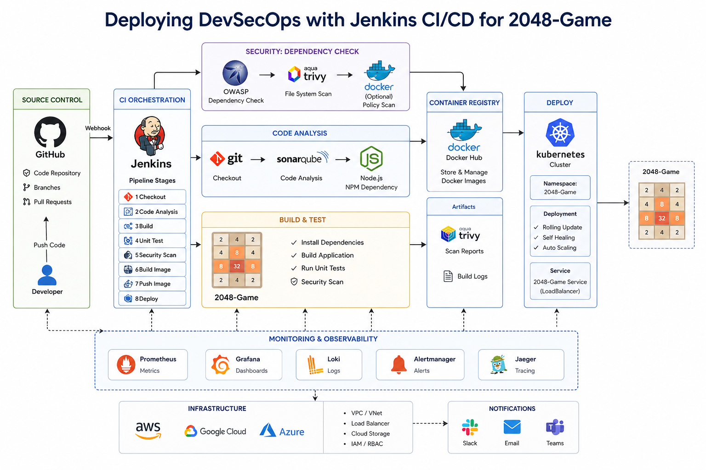
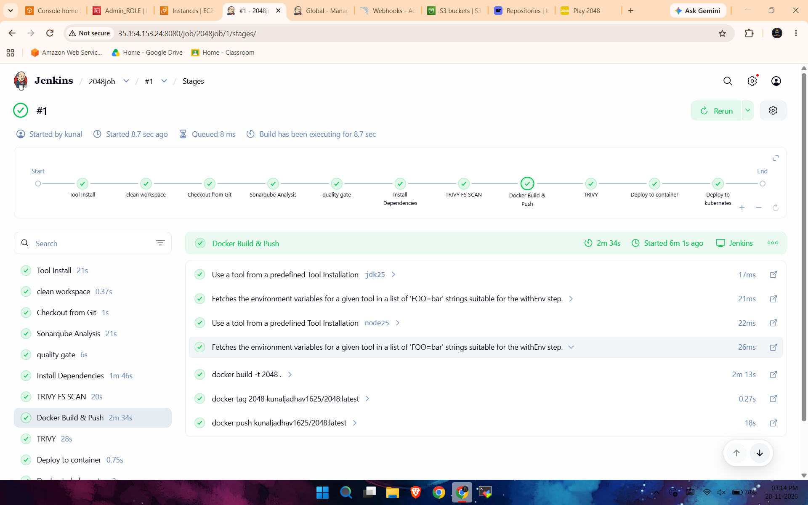
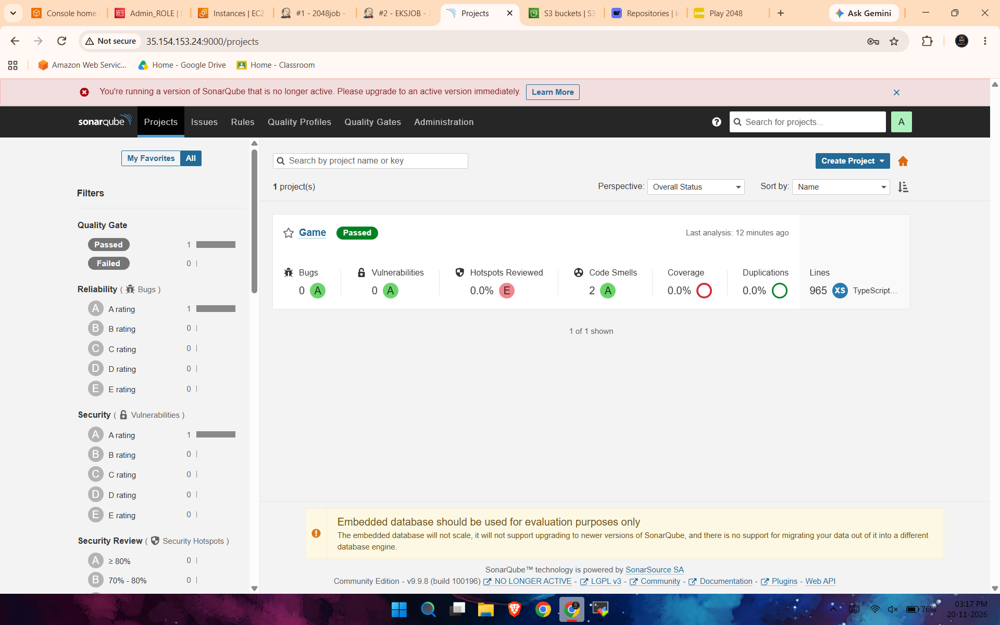
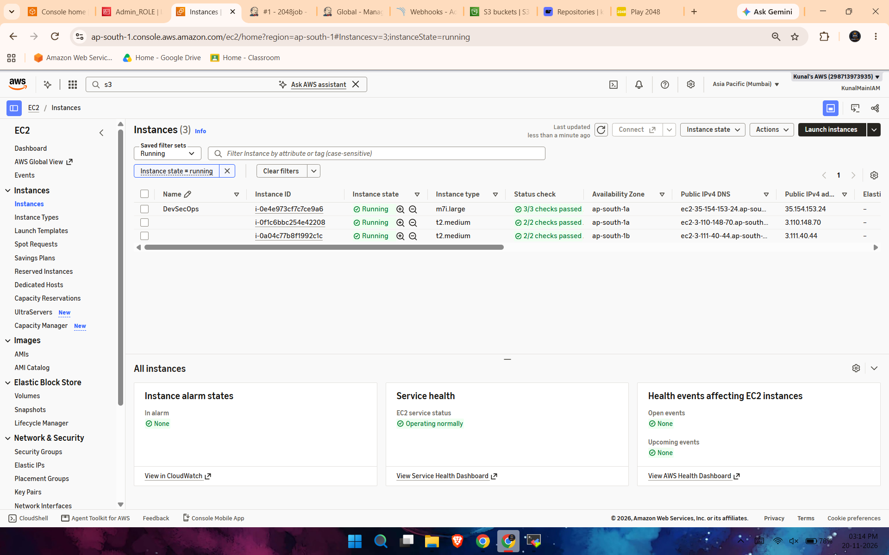
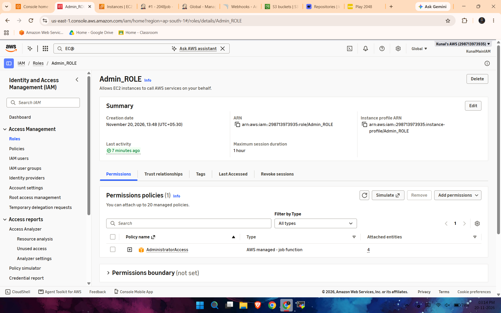

# DevSecOps CI/CD Pipeline for 2048 on Amazon EKS

<div align="center">



**An end-to-end DevSecOps implementation for building, scanning, securing, packaging, and deploying the 2048 web game on Amazon Elastic Kubernetes Service (Amazon EKS).**

[](https://aws.amazon.com/)
[](https://www.jenkins.io/)
[](https://www.docker.com/)
[](https://kubernetes.io/)
[](https://www.terraform.io/)
[](https://www.sonarqube.org/)
[](https://trivy.dev/)

</div>

---

## Table of Contents

- [Project Overview](#project-overview)
- [Architecture](#architecture)
- [Technology Stack](#technology-stack)
- [CI/CD Workflow](#cicd-workflow)
- [Prerequisites](#prerequisites)
- [Jenkins Configuration](#jenkins-configuration)
- [Infrastructure Provisioning](#infrastructure-provisioning)
- [Application Deployment](#application-deployment)
- [Security Scanning](#security-scanning)
- [Project Screenshots](#project-screenshots)
- [Repository Guide](#repository-guide)
- [Cleanup](#cleanup)
- [Troubleshooting](#troubleshooting)
- [Contributing](#contributing)
- [License](#license)
- [Author](#author)

---

## Project Overview

This repository documents a production-oriented DevSecOps workflow that combines infrastructure automation, continuous integration, security checks, container delivery, and Kubernetes deployment.

The pipeline demonstrates how to:

- Provision AWS infrastructure using Terraform
- Automate builds and deployments with Jenkins
- Analyze source code with SonarQube
- Scan dependencies and filesystems with security tools
- Build and publish container images to Docker Hub
- Deploy workloads to Amazon EKS
- Validate applications and container health
- Review infrastructure and deployment evidence

> This repository is primarily an implementation guide and evidence archive. It includes setup notes and screenshots; application source and Terraform modules may live in separate repositories as referenced in the implementation notes.

---

## Architecture

```text
Developer
    |
    | Push / Pull Request
    v
GitHub  ─── Webhook ───>  Jenkins
                              |
                              +── Source Checkout
                              +── SonarQube Analysis
                              +── Quality Gate
                              +── Dependency & Filesystem Scan
                              +── Docker Build
                              +── Container Vulnerability Scan
                              |
                              v
                        Docker Hub Registry
                              |
                              v
                       Amazon EKS Cluster
                              |
                              v
                     2048 Web Application
                              |
                              v
                    Kubernetes LoadBalancer
                              |
                              v
                        End Users
```

Infrastructure is provisioned with Terraform, and deployment state can be managed through a Jenkins pipeline or from the AWS CLI.

---

## Technology Stack

| Category | Technology |
|---|---|
| Cloud Provider | Amazon Web Services (AWS) |
| Compute | Amazon EC2, Amazon EKS |
| Networking | Amazon VPC, Security Groups, Load Balancer |
| Infrastructure as Code | Terraform |
| CI/CD | Jenkins |
| Source Control | GitHub |
| Containers | Docker |
| Orchestration | Kubernetes |
| Code Quality | SonarQube |
| Security Scanning | Trivy / OWASP Dependency-Check |
| Package Management | npm |
| Container Registry | Docker Hub |
| Remote State | Amazon S3 |

---

## CI/CD Workflow

### 1. Infrastructure Pipeline

1. Check out the infrastructure repository.
2. Initialize Terraform.
3. Validate Terraform configuration.
4. Generate an execution plan.
5. Apply or destroy AWS resources through a Jenkins parameter.
6. Create the EKS cluster and supporting infrastructure.

### 2. Application Pipeline

1. Clean the Jenkins workspace.
2. Check out the 2048 application source.
3. Run SonarQube static code analysis.
4. Wait for the configured quality gate.
5. Install npm dependencies.
6. Scan the project filesystem with Trivy.
7. Build the Docker image.
8. Push the image to Docker Hub.
9. Scan the published container image.
10. Run the container for validation.
11. Deploy the Kubernetes workload to EKS.

---

## Prerequisites

- An AWS account with permission to manage EC2, EKS, IAM, VPC, and S3
- Ubuntu-based EC2 instance
- Jenkins and Java 21 or later
- Docker and Docker Compose
- Terraform
- AWS CLI
- kubectl
- Node.js and npm
- SonarQube
- Trivy
- Docker Hub account
- GitHub account and repository
- Jenkins credentials with least-privilege access

---

## Jenkins Configuration

### Required Jenkins Plugins

- Eclipse Temurin installer
- SonarQube Scanner
- NodeJS
- OWASP Dependency-Check
- Docker
- Docker Pipeline
- Docker Commons
- Docker API
- Docker Build Step
- Kubernetes
- Kubernetes CLI

### Required Jenkins Credentials

| Credential ID | Type | Purpose |
|---|---|---|
| `sonar-token` | Secret text | SonarQube authentication |
| `docker` | Username and password | Docker Hub registry access |
| `k8s` | Secret file | Kubernetes/EKS configuration |

> Never place credentials, kubeconfig files, private keys, or access tokens in source control.

---

## Infrastructure Provisioning

Configure AWS CLI on the Jenkins host:

```bash
aws configure
aws sts get-caller-identity
```

Run Terraform manually:

```bash
terraform init
terraform validate
terraform plan
terraform apply
```

Update the kubeconfig after the cluster is created:

```bash
aws eks update-kubeconfig \
  --name EKS_CLUSTER \
  --region ap-south-1
```

Verify the cluster:

```bash
kubectl get nodes
kubectl get namespaces
kubectl get all --all-namespaces
```

---

## Application Deployment

Build and publish the container image:

```bash
docker build -t 2048 .
docker tag 2048 <dockerhub-user>/2048:latest
docker push <dockerhub-user>/2048:latest
```

Run the container locally for validation:

```bash
docker run -d \
  --name 2048 \
  -p 3000:3000 \
  <dockerhub-user>/2048:latest
```

Deploy the Kubernetes resources:

```bash
kubectl apply -f deployment.yaml
kubectl apply -f service.yaml

kubectl get pods
kubectl get deployments
kubectl get service
```

Open the external address shown by `kubectl get service` to access the 2048 game.

---

## Security Scanning

Scan the project filesystem before building:

```bash
trivy fs .
```

Scan the container image:

```bash
trivy image <dockerhub-user>/2048:latest
```

Recommended security practices:

- Rotate credentials immediately if they are exposed.
- Store secrets in Jenkins Credentials or AWS Secrets Manager.
- Restrict Jenkins and SonarQube network access.
- Use least-privilege AWS IAM policies.
- Configure explicit Trivy failure thresholds.
- Keep the Jenkins, Docker, Kubernetes, and AWS tooling updated.
- Prefer private Kubernetes and Jenkins endpoints where possible.

> [!IMPORTANT]
> This repository contains or may have contained sensitive environment artifacts. Never commit kubeconfig files, AWS credentials, Docker passwords, SonarQube tokens, certificates, or private keys. Rotate any values that have already been shared.

---

## Project Screenshots

### Jenkins Application Pipeline



### EKS Kubernetes Pipeline


### Docker Hub Images


### SonarQube Status



### AWS Infrastructure Evidence

| EC2 Instances | S3 Buckets | IAM Role |
|---|---|---|
|  |  |  |

### Deployed Application


---

## Repository Guide

| Path | Purpose |
|---|---|
| [`Architecture-diagram.png`](./Architecture-diagram.png) | DevSecOps architecture diagram |
| [`Deploying 2048 Game - new.txt`](./Deploying%202048%20Game%20-%20new.txt) | Detailed setup and Jenkins pipeline notes |
| [`errors.txt`](./errors.txt) | Recorded troubleshooting information |
| [`screenshoots/`](./screenshoots/) | AWS, Jenkins, SonarQube, Docker, Kubernetes, and application evidence |
| [`secret.txt`](./secret.txt) | Local sensitive configuration reference; do not commit or publish |

---

## Cleanup

Remove AWS infrastructure:

```bash
terraform destroy
```

Remove local containers:

```bash
docker ps -a
docker rm -f <container-id>
```

Remove the Kubernetes resources:

```bash
kubectl delete -f deployment.yaml
kubectl delete -f service.yaml
```

---

## Troubleshooting

### Docker permission denied

```bash
sudo chmod 777 /var/run/docker.sock
sudo systemctl restart docker
docker ps
```

### Jenkins cannot access Docker

```bash
sudo usermod -aG docker jenkins
sudo systemctl restart jenkins
sudo systemctl restart docker
```

### Kubernetes authentication failure

```bash
aws eks update-kubeconfig \
  --name EKS_CLUSTER \
  --region ap-south-1

kubectl get nodes
```

### Load balancer is not accessible

Check the Kubernetes service type, external IP/hostname, security groups, and public subnet configuration:

```bash
kubectl describe service
kubectl get endpoints
```

---

## Contributing

Contributions are welcome.

1. Fork the repository.
2. Create a descriptive feature branch.
3. Make focused, well-documented changes.
4. Commit with a clear message.
5. Open a pull request.

---

## License

No license has been included in this repository. Add a `LICENSE` file if you want to define reuse and distribution terms.

---

## Author

<div align="center">

# 👨‍💻 Kunal Jadhav

[](https://kunalcloud.shop/)
[](https://github.com/devkunaljadhav)
[](https://www.linkedin.com/in/devkunaljadhav)
[](mailto:kunaljadhav1625@gmail.com)

</div>
